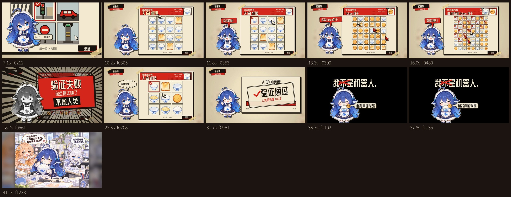

# DeepSeek 鲸鱼娘大战验证码

把提示词和素材交给AI编程助手，制作一支“为了干饭，努力证明自己是人类”的趣味短视频。

基于 [huiq777/fifi-video-prompt](https://github.com/huiq777/fifi-video-prompt) 的《AI大战验证码》改编，加入鲸鱼娘、白米饭与Token饼干。本仓库是**可复用的制作提示词与素材包**：提供完整剧情、精确分镜、透明贴片和参考预览，生成工程由编程助手完成。

## 预览

以下是本地43秒版的抽帧参考，不是网页播放器。实际生成结果会随助手实现有所不同。

[13种表情与8个道具](previews/asset_contact_sheet.jpg) · [透明背景预览页](previews/index.html)

预览HTML下载后可用浏览器打开；GitHub文件页只显示源码。

## 故事

红绿灯杆子算不算？鲸鱼娘犹豫点错。题目变成白米饭，她立刻喊“这我知道！”，连Token饼干一起秒选，结果因太快被判不像人类。她下决心装手抖、装犹豫、装点错，终于通过——“我不是机器人。”划掉“不”，再说：“但我真的很饿”。

- 关键台词给人物特写，由鲸鱼娘推动剧情。
- 装人策略属于内心思考，与验证码系统信息分开。
- 失败重砸之后，画面和全部声音停住0.6秒。
- 13种现成角色贴片，无需绑定和口型动画。

## 快速使用

1. 下载整个仓库（Code → Download ZIP）并解压，或克隆仓库。
2. 在Claude Code、Cursor Agent等能读写文件、运行命令的编程助手中打开此目录。
3. 复制 [START_HERE.md](START_HERE.md) 的开工指令给助手。
4. 助手读取素材与分镜，创建工程、生成关键帧、合成声音并输出MP4。

视频制作阶段不需要图像或视频生成模型。角色和道具是预先用AI生成、再裁切去底的现成素材。

## 默认规格

| 项目 | 配置 |
|---|---|
| 版本 | 最新43秒方案，基于本地v3.1 |
| 画面 | 1920×1080横屏，30fps，1290帧 |
| 声音 | 程序合成音效与配乐，48kHz立体声 |
| 视频 | H.264 High / yuv420p / AAC / faststart |
| 素材 | 13张角色、8张道具、1张片尾图 |
| 表演 | 贴片切换、缩放、平移、旋转、镜头裁切 |

## 制作环境

准备Node.js、Chrome/Chromium、Python 3（numpy/scipy）、ffmpeg和ffprobe。助手按生成工程安装Playwright或Puppeteer，并下载本地开源字体及许可证。无需安装依赖即可查看仓库素材和提示词。

## 文件说明

| 文件 | 用途 |
|---|---|
| [prompt.md](prompt.md) | 完整制作提示词 |
| [START_HERE.md](START_HERE.md) | 可直接复制的开工指令 |
| [STORYBOARD.md](STORYBOARD.md) | 可读分镜表 |
| [storyboard.json](storyboard.json) | 成片帧、气泡、题目、点击、配乐与静音时点 |
| [ASSET_GUIDE.md](ASSET_GUIDE.md) | 标签、锚点与使用方法 |
| [assets/manifest.json](assets/manifest.json) | 素材路径、尺寸、来源与哈希 |
| assets/characters/ | 13种透明角色 |
| assets/props/ | 8个透明道具 |
| assets/endcard/ | 工作室片尾图 |
| sources/ | 三张原始洋红底素材图 |
| previews/ | 剧情与素材预览 |

所有JSON时间是最终成片帧，无需其他工程的换算函数。不要把旧版30秒时点套进43秒分镜。

## 改成自己的版本

可以替换角色、食物、台词和片尾图。同景别切换保持统一画布和脚底锚点；happy图里的饭碗和饼干已与人物合并，独立食物特写使用props。改变时长时，同步分镜、气泡、点击、音频与静音窗口。

## 来源与许可证

原始创意与代码动画提示词结构来自 [huiq777/fifi-video-prompt](https://github.com/huiq777/fifi-video-prompt)，改编说明见 [ATTRIBUTION.md](ATTRIBUTION.md)。

[MIT](LICENSE)：可以使用、修改、转发，包括商用；分发时请保留版权声明和许可证全文。
